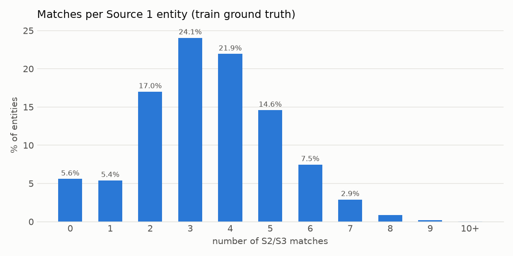
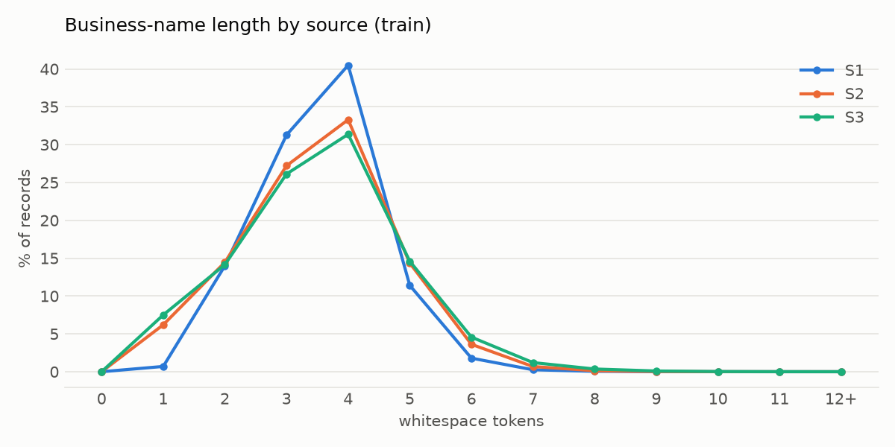
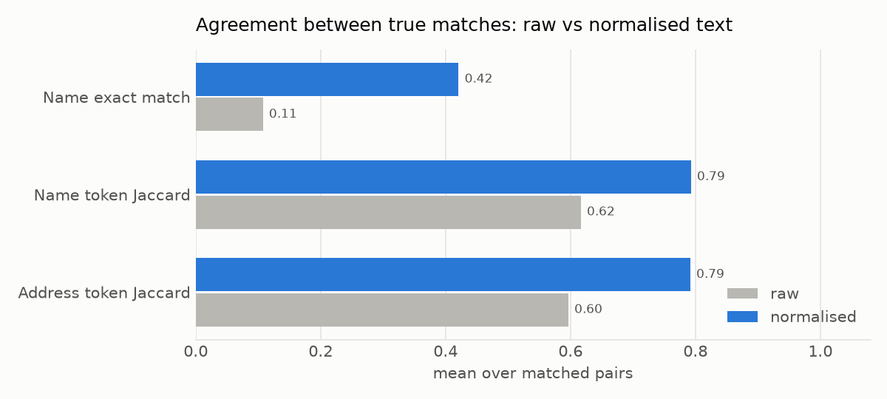

# EDA and preprocessing report: Business Entity Resolution

*Generated by `python -m src.preprocessing.eda` on 2026-09-26. All numbers are computed from
the provided files; nothing external is used.*

## 1. Files

| file | records | missing name | missing address | missing country | exact duplicate rows | name chars (median / p95) | name tokens (median / p95) | address chars (median / p95) |
|---|---|---|---|---|---|---|---|---|
| train/S1 | 2,206,821 | 0.00% | 0.00% | 0.00% | 0 | 24 / 37 | 4 / 5 | 41 / 103 |
| train/S2 | 5,034,616 | 0.00% | 3.36% | 0.00% | 25,873 | 25 / 40 | 4 / 5 | 37 / 96 |
| train/S3 | 5,285,603 | 0.00% | 3.33% | 0.00% | 18,860 | 25 / 42 | 4 / 6 | 42 / 91 |
| test/S1 | 1,732,544 | 0.00% | 0.00% | 0.00% | 0 | 24 / 36 | 4 / 5 | 50 / 105 |
| test/S2 | 4,887,273 | 0.00% | 2.65% | 0.00% | 22,641 | 25 / 42 | 4 / 5 | 43 / 99 |
| test/S3 | 5,082,316 | 0.00% | 2.68% | 0.00% | 16,293 | 25 / 42 | 4 / 6 | 43 / 94 |

"Missing" counts empty strings and placeholders such as `<NULL>`, `null`, `N/A`.

### Duplicate-looking records after normalisation

| file | duplicate (norm name + norm address + country) | duplicate (norm name + country) | empty name_norm | empty address_norm |
|---|---|---|---|---|
| train/S1 | 0 | 707,020 | 0 | 0 |
| train/S2 | 229,022 | 1,419,473 | 5 | 168,967 |
| train/S3 | 207,971 | 1,517,770 | 2 | 175,916 |
| test/S1 | 1 | 522,264 | 0 | 0 |
| test/S2 | 197,621 | 1,253,127 | 6 | 129,408 |
| test/S3 | 177,521 | 1,314,955 | 4 | 136,098 |

Within one source, many S2/S3 records collapse to the same normalised name, address and country. These are
the "several matches per entity" in the ground truth: one S1 entity usually matches several near-identical
S2/S3 variants.

**Names are not unique in Source 1.** About 32% of train S1 records (707k) share their normalised name with
another S1 entity in the same country, and only the address tells them apart. A name-only match is
therefore not enough evidence under F0.5. Blocking and matching must use the address (`addr_state`,
`addr_house_no`, `addr_street`) to separate same-name businesses.

### Country labels

| file | US | India | France |
|---|---|---|---|
| train/S1 | 1,323,633 | 883,188 | 0 |
| train/S2 | 3,016,817 | 2,017,799 | 0 |
| train/S3 | 3,170,056 | 2,115,547 | 0 |
| test/S1 | 663,106 | 809,986 | 259,452 |
| test/S2 | 1,871,330 | 2,312,565 | 703,378 |
| test/S3 | 1,945,701 | 2,405,000 | 731,615 |

Training has only **US** and **India**; test adds **France** (~15% of test S1). The pipeline treats country
as an open set (`normalize_country` passes unknown labels through, and the address parser falls back to
generic rules).

## 2. Ground truth (train)

| metric | value |
|---|---|
| source1_entities | 2,206,821 |
| singletons (0 matches) | 123,247 |
| exactly 1 match | 119,157 |
| 2+ matches | 1,964,417 |
| mean matches / entity | 3.461 |
| max matches / entity | 11 |
| total matched pairs | 7,638,365 |
| pairs to S2 | 3,693,619 |
| pairs to S3 | 3,944,746 |
| entities with S2 match only | 143,029 |
| entities with S3 match only | 164,498 |
| entities with both S2 and S3 | 1,776,047 |
| S2/S3 ids matched to >1 S1 entity | 0 |

| matches | entities | share |
|---|---|---|
| 0 | 123,247 | 5.58% |
| 1 | 119,157 | 5.40% |
| 2 | 375,212 | 17.00% |
| 3 | 530,841 | 24.05% |
| 4 | 484,115 | 21.94% |
| 5 | 321,957 | 14.59% |
| 6 | 164,868 | 7.47% |
| 7 | 63,968 | 2.90% |
| 8 | 18,680 | 0.85% |
| 9 | 4,205 | 0.19% |
| 10+ | 571 | 0.03% |

### By country

| country | entities | singleton_rate | mean_matches |
|---|---|---|---|
| India | 883,188 | 5.59% | 3.46 |
| US | 1,323,633 | 5.58% | 3.46 |

### How many S2/S3 records are ever matched?

| source | records | matched to some S1 | never matched (distractors) |
|---|---|---|---|
| S2 | 5,034,616 | 3,693,619 | 26.64% |
| S3 | 5,285,603 | 3,944,746 | 25.37% |

Many S2/S3 records never match any S1 entity. Blocking must expect a large pool of distractors, and
F0.5 rewards leaving true singletons empty.

## 3. Noise patterns

Share of records that show each pattern (regex on raw text).

| pattern (first 500,000 rows/file) | train/S1 | train/S2 | train/S3 | test/S1 | test/S2 | test/S3 |
|---|---|---|---|---|---|---|
| Indic script (any) | 0.00% | 9.34% | 5.27% | 0.00% | 11.16% | 6.33% |
| Latin accents / non-ASCII Latin | 0.00% | 5.82% | 6.21% | 2.33% | 7.81% | 8.20% |
| ALL CAPS | 0.00% | 18.91% | 3.01% | 0.00% | 17.57% | 3.20% |
| Alias marker (dba, f/k/a, formerly, t/a ...) | 0.00% | 0.00% | 2.42% | 0.00% | 0.00% | 1.78% |
| ID tail (#12345 / (ID: n)) | 0.00% | 0.61% | 0.60% | 0.00% | 0.47% | 0.47% |
| Pipe + website tail | 0.00% | 0.30% | 0.32% | 0.00% | 0.24% | 0.24% |
| Domain-style name (x.com) | 0.00% | 3.48% | 3.43% | 0.00% | 2.76% | 2.80% |
| Junk prefix (--, >>, ***, ...) | 0.09% | 1.86% | 1.85% | 0.05% | 1.41% | 1.41% |
| Bracketed part [..] / (..) | 2.06% | 7.73% | 8.00% | 3.61% | 8.29% | 8.70% |
| Digit inside a word (5tar, mem0rial) | 0.00% | 2.36% | 2.37% | 0.01% | 1.84% | 1.94% |
| Double space | 0.00% | 10.97% | 10.94% | 0.00% | 10.24% | 10.24% |
| Address: Indic script | 0.00% | 9.45% | 9.05% | 0.00% | 11.25% | 10.81% |
| Address: placeholder (<NULL>, N/A) | 0.00% | 3.46% | 3.32% | 0.00% | 2.89% | 2.78% |
| Address: zero-padded number | 0.66% | 4.70% | 4.45% | 0.78% | 4.41% | 4.17% |
| Address: PMB box | 0.00% | 0.99% | 0.94% | 0.00% | 0.63% | 0.63% |
| Address: house marker (#, No., H.no, Door No) | 14.36% | 21.41% | 21.91% | 16.57% | 25.66% | 25.45% |
| Address: repeated token (Unit Unit) | 1.08% | 0.29% | 0.56% | 0.81% | 0.29% | 0.46% |

S1 is clean: ASCII, title case, no injected junk. S2 and S3 carry the noise. They mix nine Indic scripts
(Devanagari, Bengali, Gurmukhi, Gujarati, Odia, Tamil, Telugu, Kannada, Malayalam), fully or partly
translated, and add injected accents, look-alike digits, alias markers
(`<synthetic brand> dba <real name>`), ID tails, website tails, glued domain names, shuffled words, typos
and dropped tokens. Addresses vary between state code, full name and native script, add or drop
components, reorder them, zero-pad house numbers, and inject PMB boxes.

## 4. Normalisation: what it does and whether it helps

Every raw record is turned into the standard record (`src/preprocessing/preprocessing.py`):

| field | meaning |
|---|---|
| `business_name_norm` | accent-folded, transliterated, lower-cased; alias/ID/website tails removed; legal forms canonical (`private limited` -> `pvt ltd`, `L.L.C.` -> `llc`) |
| `name_core` | `business_name_norm` minus legal forms, honorifics (Shri/Smt/M/s/The) and "and" |
| `name_legal` | canonical legal forms found |
| `name_alt` | the synthetic brand before a dba/f/k/a marker |
| `name_is_domain`, `name_script` | flags (glued domain / handle; script of the raw name) |
| `name_known_ratio` | share of core words seen in clean S1 names; 0 = brand-only name, so rely on the address |
| `name_phonetic` | consonant skeleton per core token (bridges transliteration vs English spelling) |
| `business_address_norm` | abbreviations expanded, typos fixed, state as canonical code, house markers / zero padding / PMB removed |
| `addr_street`, `addr_city`, `addr_state`, `addr_house_no`, `addr_numbers`, `addr_postcode` | parsed components that do not depend on component order |

Data-driven resources (`python -m src.preprocessing.mine_resources`, train only for anything label-based):

* `indic_token_map.tsv`: native-script token to Latin word. Tokens are aligned position by position on train
  ground-truth pairs whose token counts match, then decided by majority vote. Tokens never seen in a
  labelled pair fall back to a phonetic match against the Source-1 vocabulary.
* `native_state_map.tsv`: native-script state name to state code.
* `name_vocab.tsv` / `address_vocab.tsv`: Source-1 token counts, used for domain-name segmentation,
  look-alike-digit repair, and to stop the typo fixer from "correcting" real words.
* `brand_pieces.tsv`: syllables that recur across the synthetic brands seen before `dba`/`f/k/a`
  markers. They stop brand words (`fayevantagequo`) from being split like glued real names
  (`alliedsoftwaresystems` -> `allied software systems`).
* `reports/mined_abbreviations.tsv`: token pairs that differ between S1 and its matches. This is the
  evidence behind the abbreviation tables.

### Effect on true matches vs random non-matches (200,000 sampled train entities)

| metric | matches: all | matches: S1-S2 | matches: S1-S3 | random non-matches (same country) |
|---|---|---|---|---|
| name exact (raw, lower-cased) | 0.107 | 0.110 | 0.105 | 0.000 |
| name exact (name_norm) | 0.421 | 0.422 | 0.419 | 0.000 |
| name exact (name_core) | 0.693 | 0.708 | 0.679 | 0.000 |
| name exact (name_phonetic) | 0.712 | 0.728 | 0.697 | 0.000 |
| name token Jaccard (raw) | 0.616 | 0.608 | 0.624 | 0.030 |
| name token Jaccard (name_norm) | 0.793 | 0.800 | 0.786 | 0.060 |
| address token Jaccard (raw) | 0.596 | 0.678 | 0.520 | 0.015 |
| address token Jaccard (address_norm) | 0.792 | 0.794 | 0.789 | 0.019 |
| state agrees (when both parsed) | 0.994 | 0.994 | 0.994 | 0.068 |
| house no. agrees (when both parsed) | 0.791 | 0.789 | 0.794 | 0.001 |
| state parsed on S2/S3 side | 0.955 | 0.953 | 0.956 | 0.955 |
| S2/S3 name brand-only (name_known_ratio = 0) | 0.022 | 0.019 | 0.025 | 0.022 |

Normalisation should raise agreement between true matches without raising it between non-matches.
The last column is the baseline for random pairs from the same country.

### Hardest remaining matches (lowest name Jaccard after normalisation)

| S1 name | S2/S3 name | S1 name_norm | S2/S3 name_norm |
|---|---|---|---|
| Argo, Harris & Gile Concord, LLC | Drexvio | argo harris and gile concord llc | drexvio |
| Sterling | Vioonyxzeta #91310 | sterling | vioonyxzeta |
| Modern Mobility Digital Care | Ciracira | modern mobility digital care | ciracira |
| Lu Choice Arrow LLC | Umbrabrix | lu choice arrow llc | umbrabrix |
| Leone's Media | Zetaorbi | leones media | zetaorbi |
| IU Entertainment Private Limited | Aviaviecto | iu entertainment pvt ltd | aviaviecto |
| Best Gold | Novievo | best gold | novievo |
| Wise Labs | Yumasynve0 | wise labs | yumasynve0 |
| M L Dvorak Madison | #ml | m l dvorak madison | ml |
| Sacred & Sons | Fluxcalo | sacred and sons | fluxcalo |
| Seabaugh and Norris Flaherty Inc. | nfseabaugh.com | seabaugh and norris flaherty inc | nf sea baugh |
| Foot & Ankle United Associates Care | Quozeta | foot and ankle united associates care | quozeta |
| Sandoval Harbor Online LLC | Wexwex Co | sandoval harbor online llc | wexwex co |
| Shiv Developers Limited | Orbionyx | shiv developers ltd | orbionyx |
| Light Northern | >> Xylodelta | light northern | xylodelta |
| Star Summit | Belopyraumbra | star summit | belopyraumbra |
| Li, Bliss and Fuentes LP | Lib1issfuentesCom | li bliss and fuentes lp | lib1issfuentescom |
| Edwards, Pak and Carrillo Asia | Fayevera | edwards pak and carrillo asia | fayevera |
| Little Barbershop | Orbiriza | little barbershop | orbiriza |
| Real Global Private Limited | Fluxbrix | real global pvt ltd | fluxbrix |

These are the cases for fuzzy / phonetic features and the ML matcher: heavy typos, dropped words, and
synthetic-brand-only names.

## 5. Notes for blocking and matching

* **Country:** block within `country_norm`, but never filter to known labels. France only appears in test.
* **Names:** use `name_core` tokens and character n-grams for blocking. Glued domains and handles are
  already segmented. Compare S1 against both `business_name_norm` and `name_alt`.
* **Brand-only names** (`name_known_ratio == 0`, see section 4) cannot match on name at all. Blocking needs
  an address-only pass (house number + street + city) to recall them, and the matcher should weight
  the address for them.
* **Addresses:** `addr_state` and `addr_house_no` are strong and cheap signals. Addresses can be missing
  (see section 1); treat missing as unknown, not as a mismatch.
* **Singletons** are a large share of S1 (section 2), so keep the match threshold precision-oriented.
